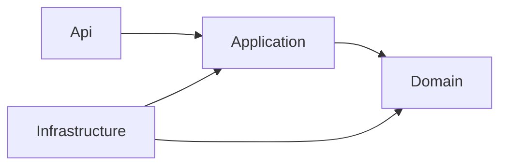
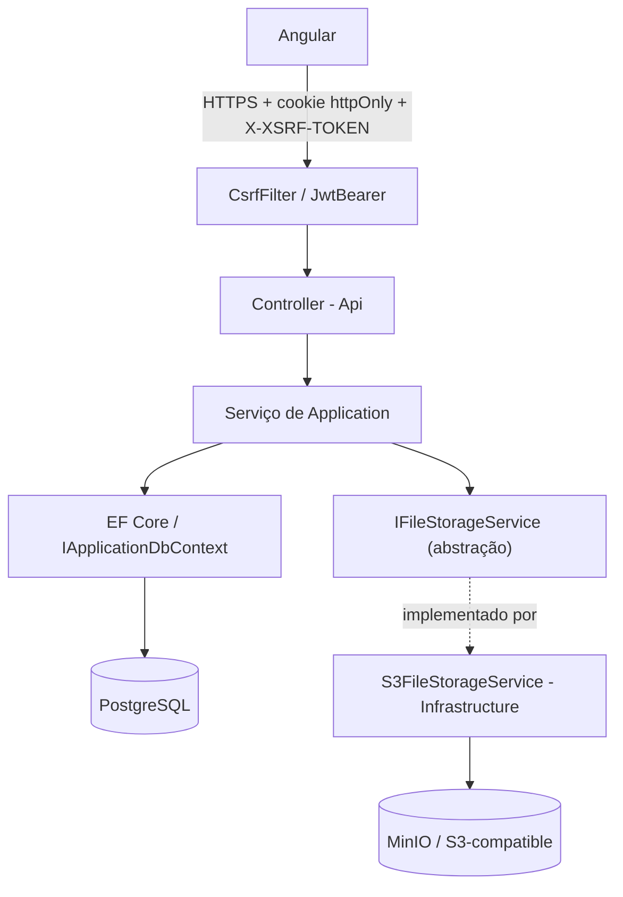

# 03 — Arquitetura

```text
Frontend Angular
    |
    | HTTPS/JSON
    v
ASP.NET Core API
    |
    +-- Domain
    +-- Application
    +-- Infrastructure
    |
    v
EF Core -> PostgreSQL

API -> MinIO / S3-compatible
API -> Application Insights (opcional)
```

## Camadas do backend (Clean Architecture)



A seta sempre aponta **pra dentro** — quem depende de quem, não fluxo de chamada. `Domain` não
referencia nenhuma outra camada (é o núcleo: entidades, enums, regras de negócio puras, sem
EF Core/ASP.NET). `Application` depende só de `Domain` — define os casos de uso (serviços,
DTOs, interfaces como `IFileStorageService`/`IEmailSender`) sem saber COMO cada interface é
implementada de fato. `Infrastructure` depende de `Application`+`Domain` e implementa essas
interfaces contra tecnologia real (EF Core/Npgsql, ASP.NET Identity, SMTP, `AWSSDK.S3`, etc.).
`Api` é a camada mais externa — Controllers, middlewares, `Program.cs` — depende de tudo, nada
depende dela.

Essa regra de dependência é o que permite trocar a implementação de armazenamento de arquivo
sem tocar em `Application`/`Domain` nem no contrato da API: `Application` só enxerga a
interface `IFileStorageService` (`SaveAsync`/`OpenReadAsync`), nunca a implementação concreta.

## Fluxo de uma requisição autenticada



`CsrfFilter`/`JwtBearerEvents.OnMessageReceived` (docs/12-seguranca.md) rodam antes de qualquer
Controller. A maioria dos fluxos só toca EF Core (`G`); a importação Excel
(`ExcelImportService`, docs/16-importacao-inicial.md) é o único caso hoje que também passa por
`IFileStorageService` — o Controller/serviço de Application nunca sabe qual provedor S3-compatible
está por trás, só o `S3FileStorageService` (em `Infrastructure`) sabe.

## Backend
```text
src/backend/
  MeuFinanceiro.Api
  MeuFinanceiro.Application
  MeuFinanceiro.Domain
  MeuFinanceiro.Infrastructure
```

## Frontend
```text
src/frontend/meu-financeiro/
  core/
  shared/
  layout/
  features/
    auth/
    dashboard/
    transactions/
    accounts/
    cards/
    categories/
    installments/
    invoices/
    recurring/
    bank-reconciliation/
    card-reconciliation/
    investments/
    projection/
    settings/
    grupo/
    admin/
    reports/
    help/
```

## Dependências externas da Infrastructure

Cada uma tem uma interface própria em `Application/Common/Interfaces` — `Infrastructure` só
implementa contra a tecnologia real. Versão exata de cada pacote em `docs/33-versions.md`.

| Dependência | Interface | Implementação |
|---|---|---|
| PostgreSQL (via Npgsql) | `IApplicationDbContext` | `AppDbContext` (EF Core) |
| MinIO / S3-compatible (via `AWSSDK.S3`) | `IFileStorageService` | `S3FileStorageService` |
| SMTP | `IEmailSender` | `SmtpEmailSender` |
| Cloudflare Turnstile | `ICaptchaVerifier` | `TurnstileCaptchaVerifier` |
| Application Insights (opcional) | — (integração direta via `Microsoft.ApplicationInsights.AspNetCore`) | — |
